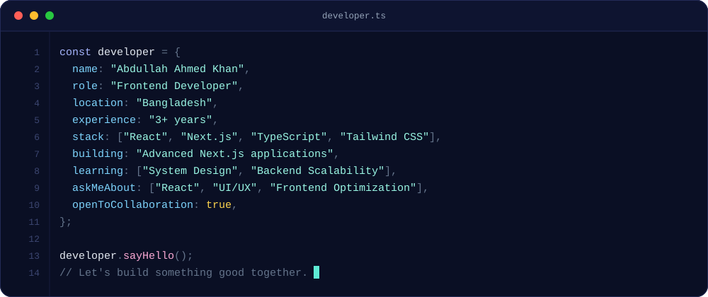
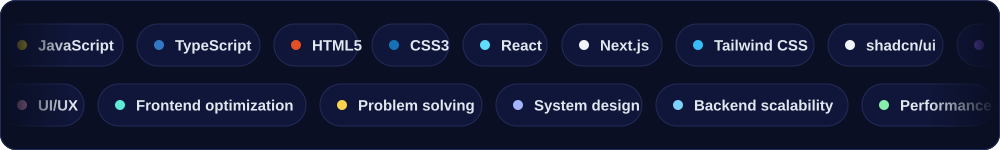

 

## About

## Stack

  

## GitHub activity

  
  

  

<!--
  Contribution snake (optional).
  1. Run the "Generate snake" workflow once: Actions tab > Generate snake > Run workflow.
  2. Remove this comment wrapper so the block below is live.

  <picture>
    <source media="(prefers-color-scheme: dark)" srcset="https://raw.githubusercontent.com/AbdullahAhmedKhan/AbdullahAhmedKhan/output/github-snake-dark.svg" />
    
  </picture>

-->

